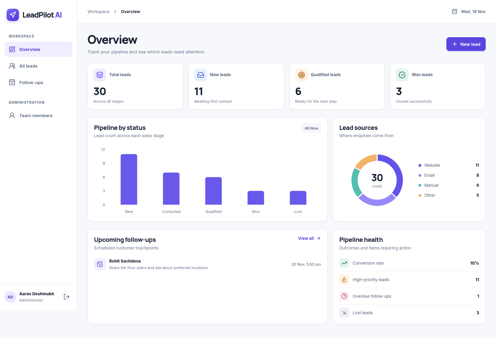
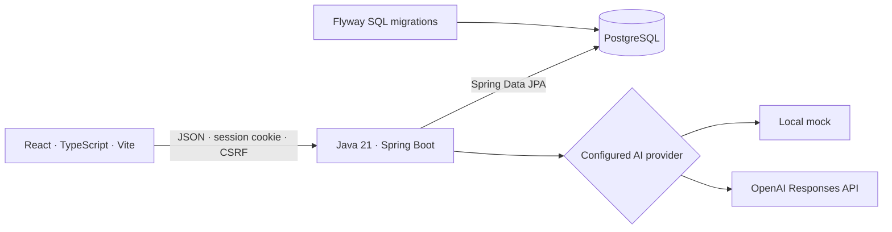

# LeadPilot AI

LeadPilot AI is a CRM for a small real-estate sales team. It puts website, email and manually captured enquiries in one place so staff can assign work, see what happened to a lead and follow up on time. The demo uses fictional Noida and Greater Noida enquiries.

## What you can do

- Sign in as an administrator or sales agent with account and lead-level permissions.
- Create, search, filter, sort and update leads, assign them to active agents, and inspect their activity history.
- Analyze an enquiry for intent, requirement, budget, timeline and a suggested next action. The mock provider works without an API key.
- Generate and edit a reply, submit it for review and record approval or rejection in the CRM.
- Schedule follow-ups, find overdue work and mark tasks complete.
- View PostgreSQL-backed metrics by status and source. Conversion is the percentage of visible leads marked won.

## Run the local demo

Install Docker with the Compose plugin, then run these commands from the repository root:

```bash
cp .env.example .env
docker compose up --build
```

Open [LeadPilot AI](http://localhost:3000) and use the local demo accounts configured in `.env`. On a fresh database the seed inserts 30 fictional leads and example follow-ups. The Compose database volume keeps records across restarts.

The [setup guide](docs/SETUP_GUIDE.md) covers native development with JDK 21, Node.js 24 and PostgreSQL, test database configuration, and every application environment setting.

## Screenshots



[Sign-in screen](docs/images/login-desktop.png) · [Mobile overview](docs/images/dashboard-mobile.png)

## Architecture



The backend is a modular monolith. Spring MVC binds requests, Spring Security establishes identity, services enforce business permissions and repositories persist data. Nginx fronts the frontend and API in the local Compose stack. The hosted image can serve the frontend and API from the same Spring process. This keeps the browser on one origin.

PostgreSQL stores accounts, leads, AI analyses, reply drafts, follow-ups and activities. Flyway applies schema versions and Hibernate validates entity mappings at startup. See the [database design and ER diagram](docs/DATABASE_DESIGN.md) and [architecture walkthrough](docs/ARCHITECTURE.md).

| Layer | Stack |
| --- | --- |
| Backend | Java 21, Spring Boot, Spring MVC, Spring Security, Jakarta Validation, Spring Data JPA, Maven Wrapper |
| Frontend | React, TypeScript, Vite, React Router, Recharts and CSS |
| Data | PostgreSQL and Flyway |
| AI | Deterministic mock provider and an optional server-side OpenAI Responses API adapter |
| Delivery and testing | Docker Compose, GitHub Actions, OpenAPI, JUnit, Mockito, Testcontainers, Vitest and Playwright |

## Configuration

Set database credentials and the local demo account details in your ignored `.env` file. The supplied [example](.env.example) uses mock AI and local HTTP settings. Use the bootstrap administrator settings for an empty hosted database where the demo seed is disabled. Set `APP_SECURE_COOKIES=true` on HTTPS. Set the real provider key and model on the backend only when using real AI. See the [environment reference](docs/SETUP_GUIDE.md#environment-settings) and [security notes](docs/SECURITY_NOTES.md).

When the local stack is running, use [Swagger UI](http://localhost:3000/swagger-ui/index.html), [OpenAPI JSON](http://localhost:3000/v3/api-docs) and the [health endpoint](http://localhost:3000/health). Sample JSON bodies and a session-aware curl example are in the [API guide](docs/API_DOCUMENTATION.md).

## Test the application

```bash
(cd backend && ./mvnw verify)
(cd frontend && npm ci && npm test && npm run build)
./scripts/evaluate-intent.sh
```

Backend integration tests use Testcontainers by default. To use an existing PostgreSQL server, point the suite at an isolated database with the `TEST_DB_*` settings. The [test report](docs/TEST_REPORT.md) records executed checks, browser steps and evaluation results.

## Repository layout

```text
backend/              Spring Boot API, migrations, demo records and backend tests
frontend/             React client, component tests and browser tests
docs/                 Setup, design, API and interview material
scripts/              Repeatable project checks
.github/workflows/    Continuous integration
docker-compose.yml    Local frontend, API and PostgreSQL services
```

## Deployment and limitations

The [deployment guide](docs/DEPLOYMENT_GUIDE.md) covers a single-origin Docker web service backed by managed PostgreSQL and describes the account access needed to publish it. The [project status](PROJECT_STATUS.md) lists verified environments and any external blockers.

This MVP supports one business. Human review controls reply approval and there is no email or WhatsApp delivery integration. Intent is a label about cues in an enquiry. It carries no calibrated purchase probability. Future improvements include organization-level isolation, stronger account recovery, provider job queues if traffic warrants them, and independently labeled evaluation data.

## Interview material

- [Project explanation with code paths](docs/PROJECT_EXPLANATION.md)
- [Interview walkthroughs, questions and a preparation checklist](docs/INTERVIEW_PREPARATION.md)
- [Resume bullets](docs/RESUME_BULLETS.md)

Official references include [Spring Boot](https://docs.spring.io/spring-boot/), [Spring Security](https://docs.spring.io/spring-security/reference/), [Spring Data JPA](https://docs.spring.io/spring-data/jpa/reference/), [PostgreSQL](https://www.postgresql.org/docs/), [React](https://react.dev/), [TypeScript](https://www.typescriptlang.org/docs/), [Vite](https://vite.dev/guide/), [Docker](https://docs.docker.com/), [GitHub Actions](https://docs.github.com/en/actions) and [OpenAI](https://developers.openai.com/api/docs/).
