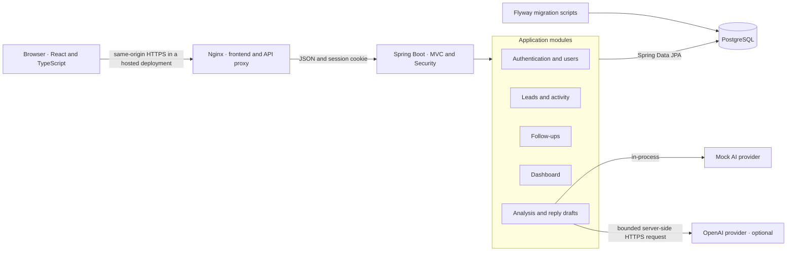
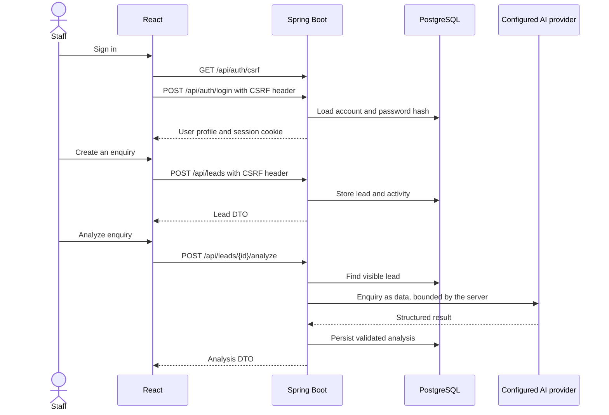

# Architecture

LeadPilot AI is a modular monolith with a React browser client, a Spring Boot API and one PostgreSQL database. Modules share a process, a deployment and relational transactions. The application uses a single business workspace.

In local Compose, Nginx serves the frontend and proxies API paths. The hosted Dockerfile serves the React bundle from the Spring Boot image and uses the host's HTTPS proxy. Both use the same browser origin for application routes and API calls.

## Module responsibilities

| Module | Responsibility |
| --- | --- |
| `auth` and `user` | Load identities, establish sessions, and administer user accounts. |
| `lead` and `activity` | Search and change leads, enforce assignment scope, and record lead activity. |
| `ai` | Analyze enquiries, draft replies, validate provider output, and manage review state. |
| `followup` | Schedule and complete follow-ups and apply lead and assignee permissions. |
| `dashboard` | Count stored records and build the status and source breakdowns. |
| `common` and `config` | Handle cross-cutting API errors and application configuration. |

A controller translates HTTP into a validated request DTO and calls a service. A service checks business rules and permissions, then builds a response from repository results. Spring Data JPA binds query parameters and maps persisted rows. API responses use DTOs so persistence mappings and fields such as password hashes stay on the server.

## Main request paths

The AI adapter can fail independently of lead entry. A lead is created before an employee asks for analysis or for a draft. The API returns a recoverable error if it cannot obtain valid AI output. The employee can still view and manage the lead.

## Design choices

- **Single relational database.** Leads, account assignments, activities, follow-ups and revisions naturally relate to one another. Foreign keys and transactions protect those relationships.
- **Session authentication.** Same-origin browser requests use an HttpOnly cookie. The server can invalidate a session at logout. A CSRF token covers state-changing endpoints.
- **Synchronous AI calls.** One analysis or draft request produces one visible result. A timeout limits the time spent waiting on the provider. A persistent job queue would make sense if measured latency or request volume made this interaction impractical.
- **Business calculation in the backend.** Database rows determine dashboard counts. The backend also computes the recommended AI priority using a rule that can be inspected and tested.
- **Separate frontend and API builds.** Vite supports quick frontend iteration. The local frontend image and hosted application image both package the resulting static assets.

For native and container startup, see the [setup guide](SETUP_GUIDE.md). For table ownership and cardinalities, see the [database design](DATABASE_DESIGN.md).
