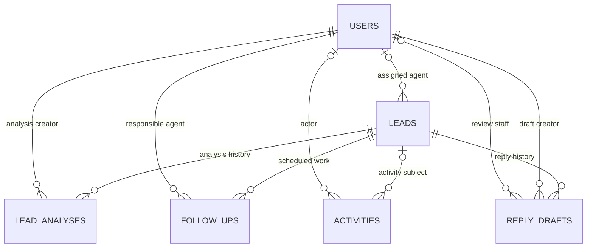

# Database design

PostgreSQL is the system of record. Flyway applies versioned SQL from `backend/src/main/resources/db/migration` at startup. Hibernate validates its mappings against the migrated schema. Production deployments should back up the database before schema upgrades and apply new migrations in order.



| Table | What a row represents |
| --- | --- |
| `users` | An account with a unique email, name, BCrypt password hash, role and active flag. |
| `leads` | A customer enquiry with contact details, source, lifecycle status, priority and an optional assigned account. |
| `lead_analyses` | A persisted AI analysis drawn from one lead's enquiry, with structured intent, extraction and priority fields. |
| `reply_drafts` | A generated or edited reply for one lead, with a workflow status and review attribution. |
| `follow_ups` | Scheduled work for a lead and responsible user, with a due date and completion information. |
| `activities` | A dated record of an action on a lead, linked to the actor when available. |

## Constraints and lifecycle

- Foreign keys enforce ownership relationships. Deleting a lead removes its dependent analyses, drafts and follow-ups while retaining an activity trail keyed by the original subject ID.
- A unique lead fingerprint is a SHA-256 digest of the normalized email and trimmed enquiry, joined with a newline. A repeat of the same intake is a conflict. The same email can submit a different enquiry. The unique database constraint also covers simultaneous submissions.
- Lifecycle fields use enumerated values in the Java API and database constraints where defined. These keep values such as lead status and draft review state in the expected sets.
- Search, assignment, dashboard and due-date operations have indexes relevant to their access paths. The most helpful index for a growing dataset depends on the query plan and data distribution.
- Lead, user, draft and follow-up rows use a version for optimistic locking. Concurrent incompatible updates can be surfaced to staff as a conflict.
- Business timestamps use UTC instants and PostgreSQL time-zone-aware types. PostgreSQL preserves the instant and renders it in the current session timezone. The browser formats the same instant in the viewer's timezone.
- The local demo seeder inserts fictional Noida and Greater Noida enquiries when explicitly enabled. Database records remain authoritative after seeding.

## Example queries

A dashboard status breakdown can be represented in SQL as follows. The service applies access scope to the records it counts.

```sql
SELECT status, COUNT(*) AS lead_count
FROM leads
GROUP BY status
ORDER BY status;
```

An agent's own lead list can use an assignment predicate and a deterministic order. Pagination in the API uses zero-based page numbers.

```sql
SELECT id, customer_name, status, created_at
FROM leads
WHERE assigned_user_id = 7
ORDER BY created_at DESC, id DESC
LIMIT 20 OFFSET 0;
```

The mock AI evaluation fixtures live with the test code and serve a different purpose from the database seed. The seed makes the application demonstrable. The fixtures measure agreement with explicit intent labels.

See [architecture](ARCHITECTURE.md) for module ownership and [interview preparation](INTERVIEW_PREPARATION.md#dbms-and-sql) for schema questions.
